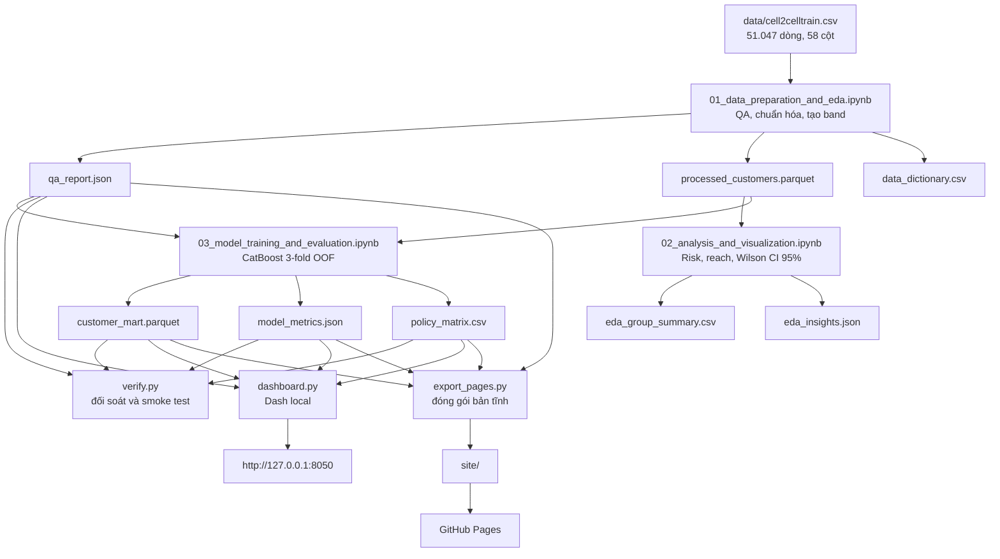

# Pipeline và công dụng các file trong dự án `ck`

Tài liệu này mô tả luồng xử lý của dự án **Cell2Cell Churn & Retention Intelligence**, vai trò của từng file/thư mục quan trọng và quan hệ đầu vào–đầu ra giữa chúng.

> Phạm vi liệt kê tập trung vào file nguồn, cấu hình, tài liệu và artifact của dự án. Các file nội bộ của Git, package nằm trong `.venv` và bytecode trong `__pycache__` không được liệt kê riêng từng file vì chúng không chứa logic nghiệp vụ.

## 1. Mục tiêu của dự án

Dự án dùng dữ liệu khách hàng viễn thông trong `data/cell2celltrain.csv` để:

1. kiểm tra và chuẩn hóa dữ liệu nguồn;
2. phân tích các nhóm có risk và reach đáng chú ý;
3. huấn luyện CatBoost và tạo điểm rủi ro ngoài mẫu cho từng khách hàng;
4. chia khách hàng thành risk decile, nhóm ưu tiên và reason code;
5. trình bày kết quả bằng dashboard Dash chạy local hoặc site tĩnh trên GitHub Pages;
6. đưa ra giả thuyết chính sách giữ chân để thử nghiệm, không khẳng định quan hệ nhân quả hay uplift khi chưa có treatment/control.

## 2. Sơ đồ pipeline tổng thể



`work/pipeline/run_all.py` là bộ điều phối: nó chạy ba notebook theo thứ tự 01 → 02 → 03. Script này không tự chứa logic làm sạch, phân tích hay mô hình hóa.

## 3. Pipeline chi tiết

### Bước 0 — Khóa phạm vi và hợp đồng dữ liệu

File `project_contract.md` định nghĩa:

- đơn vị quan sát là một khách hàng trong một snapshot;
- target `Churn`: `Yes = 1`, `No = 0`;
- baseline dùng toàn bộ 51.047 dòng hợp lệ, không dùng complete-case 58 cột;
- 10 feature được phép đưa vào mô hình;
- chín câu hỏi kinh doanh và bốn trang dashboard;
- quy tắc mẫu số, giới hạn diễn giải và nguyên tắc chính sách.

Đây là hợp đồng mà các notebook và dashboard phải tuân thủ.

### Bước 1 — Nạp dữ liệu, QA và tạo processed layer

File thực thi: `work/pipeline/01_data_preparation_and_eda.ipynb`.

Đầu vào:

- `data/cell2celltrain.csv`.

Xử lý chính:

- tìm project root dựa trên vị trí của `data/` và `work/`;
- tính SHA-256 của CSV để nhận diện phiên bản nguồn;
- kiểm tra đủ cột bắt buộc, số dòng, số cột, ID, target và số churner;
- chỉ lấy `CustomerID`, `Churn` và 10 feature đã khóa;
- ép kiểu numeric, chuẩn hóa categorical và thay categorical missing bằng `Unknown`;
- ghi nhận missing và giá trị âm nhưng không tự ý xóa/sửa dữ liệu nguồn;
- giữ đủ 51.047 dòng, kể cả 368 dòng thiếu ít nhất một predictor;
- tạo các band phục vụ biểu đồ: tenure, tuổi thiết bị, value, charge, minutes, usage trend và revenue trend;
- chạy các checkpoint bằng `assert` trước khi ghi artifact.

Đầu ra trong `work/build/`:

- `processed_customers.parquet`;
- `qa_report.json`;
- `data_dictionary.csv`.

### Bước 2 — Phân tích và trực quan hóa EDA

File thực thi: `work/pipeline/02_analysis_and_visualization.ipynb`.

Đầu vào:

- `work/build/processed_customers.parquet`;
- `work/build/qa_report.json`.

Xử lý chính:

- không đọc và không làm sạch lại CSV raw;
- tính `n`, churner, churn rate cho từng nhóm;
- tính Wilson confidence interval 95% cho tỷ lệ churn;
- đặt risk cạnh reach để tránh chỉ nhìn tỷ lệ của nhóm quá nhỏ;
- phân tích tenure, thiết bị/web capability, value, recurring charge, mức sử dụng và thay đổi sử dụng;
- kiểm tra một số kết quả kỳ vọng bằng `assert`;
- chỉ diễn giải quan hệ quan sát, không diễn giải là nguyên nhân.

Đầu ra trong `work/build/`:

- `eda_group_summary.csv` — bảng tổng hợp theo nhóm, không chứa `CustomerID`;
- `eda_insights.json` — các số insight chính dùng để đối soát hoặc viết nội dung.

### Bước 3 — Huấn luyện, đánh giá và phân khúc

File thực thi: `work/pipeline/03_model_training_and_evaluation.ipynb`.

Đầu vào:

- `work/build/processed_customers.parquet`;
- `work/build/qa_report.json`;
- `data/cell2celltrain.csv`, chỉ để kiểm tra hash nguồn vẫn khớp.

Xử lý mô hình:

- dùng 52 cột nguồn theo `project_contract.md` mục 5 (10 base feature từ notebook 01 + các cột còn lại ghép từ raw CSV);
- `CustomerID` không được dùng làm predictor;
- dùng CatBoost để xử lý đồng thời feature numeric, categorical và missing;
- outer `StratifiedKFold` 3 fold tạo `RiskScore` ngoài mẫu cho toàn bộ khách hàng;
- bên trong từng outer training fold, một inner validation chọn depth 4 hoặc 6 và số iteration bằng log loss/early stopping;
- fit lại trên outer train rồi mới dự đoán outer holdout;
- kiểm tra mỗi dòng được chấm đúng một lần và không có score thiếu;
- tính ROC-AUC, PR-AUC, log loss, Brier score và lift/precision/recall tại capacity 5%, 10%, 20%;
- chia `RiskDecile` từ 1 đến 10, với decile 10 là rủi ro cao nhất.

Xử lý nghiệp vụ sau mô hình:

- tạo `PrioritySegment` P1–P4 từ risk decile và `MonthlyRevenue`;
- tạo một `ReasonCode` theo rule có thứ tự ưu tiên;
- lập policy matrix gồm eligibility, treatment hypothesis, KPI, guardrail và trạng thái pilot;
- reason code là rule rà soát, không phải SHAP hoặc bằng chứng nguyên nhân.

Đầu ra trong `work/build/`:

- `customer_mart.parquet`;
- `model_metrics.json`;
- `policy_matrix.csv`.

### Bước 4 — Kiểm tra artifact và dashboard

File thực thi: `work/dashboard/verify.py`.

Script kiểm tra:

- mart có đúng 51.047 khách và 14.711 churner;
- `CustomerID` duy nhất;
- mô hình có ba fold và có thông tin chọn depth;
- mọi `RiskScore` nằm trong `[0, 1]` và không bị thiếu;
- đủ risk decile 1–10;
- mọi khách có priority segment và reason code;
- ROC-AUC tính lại từ mart khớp `model_metrics.json`;
- policy matrix phủ đủ reason code;
- bốn route của dashboard render được với cả toàn bộ dữ liệu và một lát cắt có filter.

Đây là smoke test và kiểm tra hợp đồng artifact, không phải bộ unit test đầy đủ cho từng hàm.

### Bước 5A — Dashboard Dash chạy local

File thực thi: `work/dashboard/dashboard.py`.

Dashboard đọc khi khởi động:

- `customer_mart.parquet`;
- `qa_report.json`;
- `model_metrics.json`;
- `policy_matrix.csv`.

Các trang:

1. `/` — Overview;
2. `/drivers` — Drivers;
3. `/risk` — Risk & Segments;
4. `/strategy` — Retention Strategy.

Bộ lọc chung gồm tenure, web capability, value tier và risk decile. Callback lọc `customer_mart`, tính lại các số liệu của lát cắt và render trang tương ứng. CSS được Dash tự nạp từ `work/dashboard/assets/style.css`.

Dashboard local chạy tại `http://127.0.0.1:8050` và không phải backend scoring cho khách hàng mới.

### Bước 5B — Site tĩnh cho GitHub Pages

File thực thi: `work/dashboard/export_pages.py`.

Script này:

- đọc mart, QA, metric và policy;
- chỉ lấy các band, target và risk score cần cho dashboard tĩnh;
- mã hóa category thành integer và ghi dictionary tương ứng;
- không xuất `CustomerID` hoặc giá trị revenue/charge chính xác;
- copy ba file nguồn trong `work/dashboard/pages_src/`;
- nhúng Plotly JS local;
- tạo đúng sáu file trong `site/` và kiểm tra không rò chuỗi `CustomerID`.

`site/data.json` vẫn chứa dữ liệu cấp dòng theo band, target và score. Vì vậy bản tĩnh không nên được coi là hoàn toàn ẩn danh.

### Bước 6 — CI/CD GitHub Pages

File `.github/workflows/pages.yml` chạy khi push vào default branch `main`/`master` hoặc khi chạy thủ công:

1. checkout source;
2. cài Python 3.11 và dependency;
3. chạy pipeline;
4. chạy `verify.py`;
5. chạy `export_pages.py`;
6. upload thư mục `site/`;
7. deploy lên GitHub Pages.

Nếu pipeline, kiểm tra hoặc export lỗi thì workflow dừng trước bước deploy.

## 4. Công dụng của từng file và thư mục

### 4.1. File ở root

| File/thư mục | Loại | Công dụng |
|---|---|---|
| `README.md` | Tài liệu vận hành | Hướng dẫn cài dependency, chạy pipeline, dashboard local, bản Pages; mô tả kiến trúc, artifact, số liệu chính và giới hạn. |
| `PIPELINE_VA_CAU_TRUC_DU_AN.md` | Tài liệu kiến trúc | File hiện tại; mô tả pipeline, dependency và vai trò của các file. |
| `project_contract.md` | Hợp đồng dự án | Khóa phạm vi, target, cohort, feature, câu hỏi kinh doanh, quy tắc mẫu số và tiêu chí của demo. |
| `progress.md` | Nhật ký tiến độ | Theo dõi trạng thái M0–M7, kết quả đã kiểm tra, việc còn chờ và block trước khi dùng thật/publish. |
| `MODEL_CARD.md` | Tài liệu mô hình | Mô tả CatBoost, feature, phương pháp OOF, metric, intended use, hạn chế và cảnh báo fairness. |
| `INSIGHTS_AND_POLICY.md` | Tài liệu phân tích | Tóm tắt insight EDA, phân khúc, reason code và các giả thuyết policy/KPI/guardrail. |
| `HUONG_DAN_THUYET_TRINH.md` | Kịch bản demo | Hướng dẫn trình bày dashboard, nội dung nên nói theo từng trang và cách trả lời câu hỏi. |
| `.gitignore` | Cấu hình Git | Bỏ qua môi trường ảo, build, site, log CatBoost, cache Python, thư mục `back` và file Excel tạm. |
| `.vscode/settings.json` | Cấu hình IDE local | Thiết lập riêng cho VS Code; không tham gia pipeline dữ liệu. |

### 4.2. Dữ liệu nguồn

| File | Công dụng |
|---|---|
| `data/cell2celltrain.csv` | Nguồn raw duy nhất: 51.047 khách, 58 cột. Notebook 01 đọc file này nhưng không ghi đè lên nó. File có `CustomerID`, vì vậy cần cân nhắc quyền riêng tư trước khi public repository. |

### 4.3. Mã nguồn pipeline

| File | Công dụng |
|---|---|
| `work/pipeline/run_all.py` | Đọc JSON của ba notebook, chạy mọi code cell bằng `exec` trong namespace riêng của từng notebook và dừng ngay khi có exception/assert fail. Không cần Jupyter để chạy. |
| `work/pipeline/01_data_preparation_and_eda.ipynb` | Kiểm tra raw, chuẩn hóa 10 feature, tạo QA, band và processed layer. |
| `work/pipeline/02_analysis_and_visualization.ipynb` | Phân tích risk/reach và Wilson CI theo các chiều nghiệp vụ; xuất bảng EDA và insight. |
| `work/pipeline/03_model_training_and_evaluation.ipynb` | Huấn luyện CatBoost OOF, đánh giá, tạo score/decile/segment/reason code và policy matrix. |

Lưu ý: `run_all.py` chỉ thực thi code cell; markdown cell dùng để giải thích khi mở notebook. Script không ghi output ngược vào file `.ipynb`.

### 4.4. Mã nguồn dashboard local

| File/thư mục | Công dụng |
|---|---|
| `work/dashboard/dashboard.py` | Ứng dụng Dash bốn trang; đọc artifact, áp bộ lọc, tính KPI/bảng/biểu đồ và phục vụ tại port 8050. |
| `work/dashboard/assets/style.css` | Giao diện của dashboard Dash: layout, sidebar, KPI card, panel, bảng, policy card và responsive CSS. Dash tự tìm thư mục `assets`. |
| `work/dashboard/verify.py` | Đối soát dữ liệu, score, segment, policy và smoke-test bốn route dashboard. |
| `work/dashboard/export_pages.py` | Chuyển artifact sang payload tĩnh không có ID và build thư mục `site/` cho GitHub Pages. |

### 4.5. Nguồn của dashboard tĩnh

| File | Công dụng |
|---|---|
| `work/dashboard/pages_src/index.html` | HTML shell của site tĩnh: sidebar, navigation, filters, vùng nội dung và phần nạp JS/CSS. |
| `work/dashboard/pages_src/app.js` | Logic dashboard chạy hoàn toàn trên trình duyệt: đọc `data.json`, giải mã category, lọc, tính KPI và vẽ Plotly cho bốn trang. |
| `work/dashboard/pages_src/style.css` | CSS riêng của bản tĩnh; gần giống giao diện Dash nhưng dùng class/DOM của trang HTML tĩnh. |

Hai bộ CSS không dùng thay thế trực tiếp cho nhau: `assets/style.css` phục vụ component Dash, còn `pages_src/style.css` phục vụ HTML/JavaScript tĩnh.

### 4.6. Dependency và workflow

| File | Công dụng |
|---|---|
| `work/requirements.txt` | Khóa khoảng phiên bản của pandas, NumPy, SciPy, scikit-learn, CatBoost, Dash, Plotly và PyArrow. |
| `.github/workflows/pages.yml` | Workflow tái tạo artifact từ raw, kiểm tra, build site và deploy GitHub Pages. |

### 4.7. Artifact trong `work/build/`

`work/build/` là đầu ra có thể tái tạo và bị `.gitignore` bỏ qua.

| Artifact | Được tạo bởi | Được dùng bởi | Nội dung |
|---|---|---|---|
| `qa_report.json` | Notebook 01 | Notebook 02, 03, dashboard, verify, export | Hash nguồn, số dòng/cột, target, missing, giá trị âm và cảnh báo dữ liệu. |
| `processed_customers.parquet` | Notebook 01 | Notebook 02, 03 | Một dòng/khách, 10 feature đã chuẩn hóa, target và các analysis band. |
| `data_dictionary.csv` | Notebook 01 | Đối soát/tài liệu | Tên cột, vai trò, dtype và số missing của processed layer. |
| `eda_group_summary.csv` | Notebook 02 | Đối soát/tài liệu | `n`, churner, rate và Wilson CI theo từng group. |
| `eda_insights.json` | Notebook 02 | Đối soát/tài liệu | Một số tỷ lệ nổi bật và nhãn giới hạn diễn giải. |
| `customer_mart.parquet` | Notebook 03 | Dashboard, verify, export | Processed data cộng `RiskScore`, `RiskDecile`, value priority, P1–P4 và reason code. |
| `model_metrics.json` | Notebook 03 | Dashboard, verify, export | Metric tổng, metric từng fold, cấu hình được chọn và kết quả capacity. |
| `policy_matrix.csv` | Notebook 03 | Dashboard, verify, export | Reason code, eligibility, treatment hypothesis, KPI, guardrail và trạng thái. |
| `qa_report_before_reorg.json` | Artifact cũ/local | Không nằm trong pipeline hiện tại | Bản QA trước khi tái cấu trúc; không được code hiện tại đọc. Có thể dùng đối chiếu lịch sử. |
| `catboost_info/` | CatBoost | Chẩn đoán local | Log học, test, thời gian và event file của CatBoost; không phải input bắt buộc của dashboard. |

### 4.8. Site đã build trong `site/`

`site/` được `export_pages.py` tạo lại và bị `.gitignore` bỏ qua.

| File | Công dụng |
|---|---|
| `site/index.html` | Bản copy từ `pages_src/index.html`. |
| `site/app.js` | Bản copy từ `pages_src/app.js`. |
| `site/style.css` | Bản copy từ `pages_src/style.css`. |
| `site/data.json` | Payload được export từ mart/QA/metric/policy; không có `CustomerID` nhưng vẫn là dữ liệu cấp dòng đã rút gọn. |
| `site/plotly.min.js` | Plotly JavaScript được đóng gói local để trang không phụ thuộc CDN cho thư viện biểu đồ. |
| `site/.nojekyll` | Báo GitHub Pages phục vụ file tĩnh trực tiếp, không xử lý bằng Jekyll. |

Không sửa trực tiếp file trong `site/`, vì lần export tiếp theo sẽ ghi lại chúng. Muốn đổi giao diện hoặc logic, sửa file tương ứng trong `work/dashboard/pages_src/`.

### 4.9. File/thư mục local hoặc sinh tự động khác

| File/thư mục | Công dụng |
|---|---|
| `.venv/` | Môi trường Python local và các package đã cài. Có thể tạo lại từ `work/requirements.txt`; không tham gia source control. |
| `__pycache__/`, `*.pyc` | Bytecode cache do Python sinh ra; có thể xóa và tự tạo lại. |
| `catboost_info/` ở root | Log do CatBoost tạo theo working directory của lần chạy. Không phải input nghiệp vụ và đã bị ignore. |
| `back/analysis_pipeline (1).md` | Tài liệu pipeline phiên bản cũ, chỉ để tham khảo lịch sử. |
| `back/project_context (1).md` | Bối cảnh dự án phiên bản cũ, không phải hợp đồng hiện hành. |
| `back/timeline (1).xlsx` | Timeline phiên bản cũ. |

Khi nội dung trong `back/` mâu thuẫn với `project_contract.md`, dùng `project_contract.md`.

## 5. Quan hệ input/output cần nhớ

| Thành phần | Input bắt buộc | Output/chức năng |
|---|---|---|
| Notebook 01 | Raw CSV | QA + processed + dictionary |
| Notebook 02 | Processed + QA | EDA summary + insight |
| Notebook 03 | Processed + QA + raw hash | Mart + model metrics + policy |
| `verify.py` | QA + mart + metrics + policy | PASS/exception; không tạo artifact nghiệp vụ |
| `dashboard.py` | QA + mart + metrics + policy | Dashboard local |
| `export_pages.py` | QA + mart + metrics + policy + `pages_src` | `site/` |
| GitHub Actions | Source repo + raw CSV | Pipeline đã kiểm tra và site được deploy |

Đáng chú ý: dashboard hiện không đọc trực tiếp `eda_group_summary.csv` hoặc `eda_insights.json`; nó tính lại số liệu từ `customer_mart.parquet` theo bộ lọc đang chọn. Hai artifact EDA chủ yếu phục vụ kiểm tra, tái sử dụng phân tích và tài liệu.

## 6. Cách chạy dự án

### Chạy đầy đủ bản local

```powershell
python -m pip install -r work/requirements.txt
python work/pipeline/run_all.py
python work/dashboard/verify.py
python work/dashboard/dashboard.py
```

Mở `http://127.0.0.1:8050/`.

### Build và xem trước bản GitHub Pages

```powershell
python work/pipeline/run_all.py
python work/dashboard/verify.py
python work/dashboard/export_pages.py
python -m http.server 8765 --directory site
```

Mở `http://127.0.0.1:8765/`.

## 7. Các hợp đồng quan trọng khi sửa code

- Không sửa trực tiếp raw CSV trong pipeline.
- Không đổi 10 model feature nếu chưa cập nhật `project_contract.md`, notebook 01, notebook 03, model card và kiểm tra liên quan.
- Notebook 02 và 03 phải đọc processed layer thay vì tự làm sạch raw theo một logic khác.
- Mọi score báo cáo phải là score ngoài mẫu; không dùng prediction trên chính dữ liệu fit để báo metric.
- `CustomerID` chỉ để ghép/đối soát, không dùng làm predictor và không được export sang Pages.
- Churn rate phải dùng mẫu số của đúng lát cắt sau lọc và nên đi cùng `n`/churner.
- Không gọi correlation, risk score hoặc reason code là nguyên nhân churn.
- Không báo ROI/uplift khi chưa có cost, margin/CLV và kết quả treatment/control.
- Không sửa `work/build/` hoặc `site/` như source; hãy sửa notebook/script nguồn rồi chạy lại pipeline/export.

